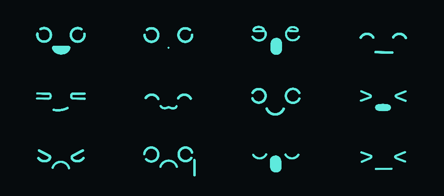
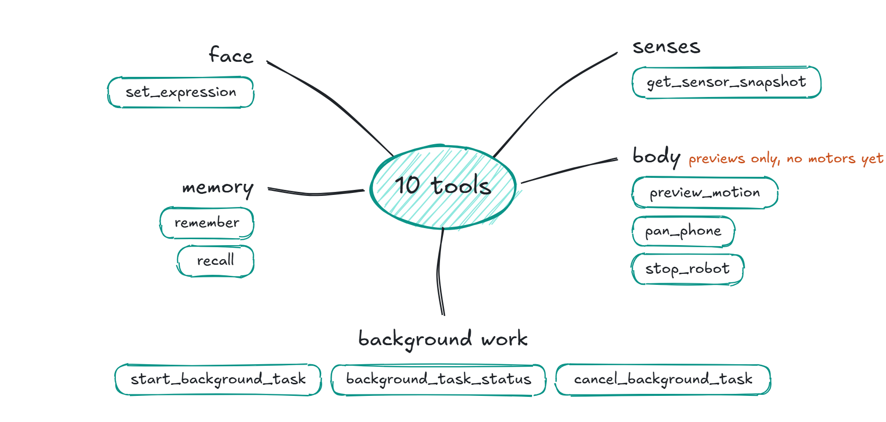
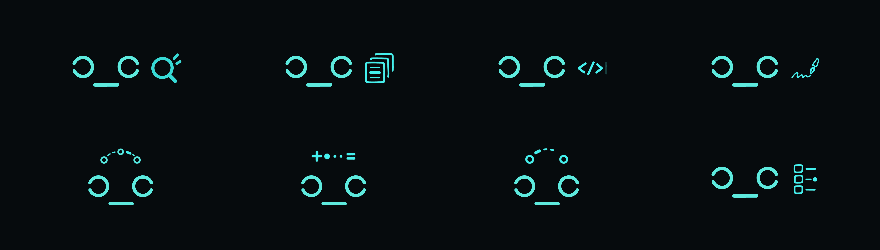

<p align="center">
  
</p>

<h1 align="center">MIST</h1>

<p align="center">A voice companion with a face.</p>

<p align="center">
  <a href="https://silmoon04.github.io/mist/">Live page</a>
  &nbsp;·&nbsp;
  <a href="https://github.com/silmoon04/mist-robot">Robot body</a>
</p>

## Faces

<p align="center">
  
</p>

## How it works

<p align="center">
  <picture>
    <source media="(prefers-color-scheme: dark)" srcset="docs/readme/how-dark.png">
    <source media="(prefers-color-scheme: light)" srcset="docs/readme/how-light.png">
    
  </picture>
</p>

## Tools

<p align="center">
  <picture>
    <source media="(prefers-color-scheme: dark)" srcset="docs/readme/tools-dark.png">
    <source media="(prefers-color-scheme: light)" srcset="docs/readme/tools-light.png">
    
  </picture>
</p>

The face shows what MIST is busy with.

<p align="center">
  
</p>

## Run it

```sh
python -m pip install -r requirements.txt    # Python 3.12
python brain/duplex/live_studio.py --port 9053
```

Open `http://127.0.0.1:9053`. The faces need no keys. To talk, set the keys named in [`.env.example`](.env.example).

Hosting, saved data and tests are in the [guide](brain/deploy/GUIDE.md).
