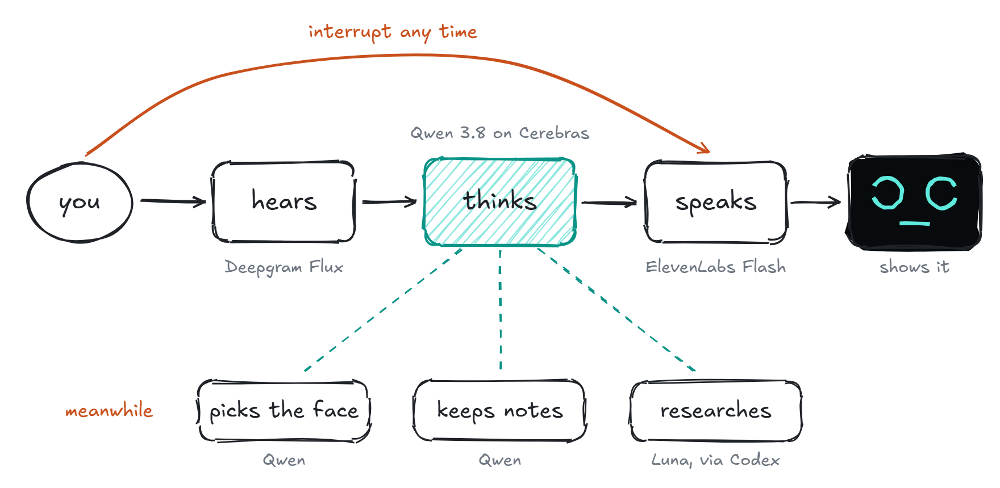

<p align="center">
  
</p>

<h1 align="center">MIST</h1>

<p align="center">A voice companion with a face.</p>

<p align="center">
  <a href="https://silmoon04.github.io/mist/">Live page</a>
  &nbsp;·&nbsp;
  <a href="https://github.com/silmoon04/mist-robot">Robot body</a>
</p>

Talk to MIST out loud and MIST talks back, with a face that changes as the conversation does. Interrupt whenever you like. MIST remembers what you ask it to, and can go and research something while you keep talking.

## Faces

<p align="center">
  
</p>

MIST has 40 faces. Each time you finish speaking, a small separate model reads the last few lines of the conversation and picks the face that fits. The mouth follows the voice.

## How it works

<p align="center">
  <picture>
    <source media="(prefers-color-scheme: dark)" srcset="docs/readme/how-dark.png">
    <source media="(prefers-color-scheme: light)" srcset="docs/readme/how-light.png">
    
  </picture>
</p>

One turn passes through four steps:

1. **Deepgram Flux** turns your speech into text and works out when you have finished.
2. **Qwen 3.8**, running on Cerebras, writes the reply.
3. **ElevenLabs Flash** speaks the reply phrase by phrase, so the voice starts before the reply is finished.
4. The browser draws the face.

Speak over MIST and the voice stops.

Three helpers work off to the side, so a reply never waits for them. A second Qwen picks the face. A third keeps a running summary of the conversation. Luna, through the Codex CLI, does the slow research.

## Tools

<p align="center">
  <picture>
    <source media="(prefers-color-scheme: dark)" srcset="docs/readme/tools-dark.png">
    <source media="(prefers-color-scheme: light)" srcset="docs/readme/tools-light.png">
    
  </picture>
</p>

While answering, Qwen can call ten tools. The quick ones finish inside the turn: change the face, save a note, search past conversations, read the sensors. The slow ones start a background job and return straight away, so MIST keeps talking and brings the answer back when it is ready. Two jobs can run at once.

The body tools only preview a move for now: no motors are connected.

While a tool runs, a small animation beside the face shows what MIST is busy with.

<p align="center">
  
</p>

## Run it

```sh
python -m pip install -r requirements.txt    # Python 3.12
python brain/duplex/live_studio.py --port 9053
```

Open `http://127.0.0.1:9053`. The faces need no keys. To talk, set the keys named in [`.env.example`](.env.example).

Hosting, saved data and tests are in the [guide](brain/deploy/GUIDE.md).
